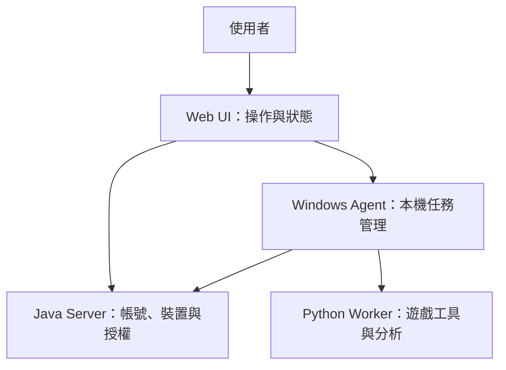

# 多使用者遊戲操作平台

獨立設計與開發多使用者平台，透過 Web 控制台管理帳號、裝置與任務，由客戶端執行本機操作，並將遊戲相關工具與分析能力拆分。

## 系統架構與流程

使用者登入並選擇裝置及任務；Server 管理帳號、功能資格與授權有效期；Agent 在本機管理任務啟停及資源清理，並按需呼叫 Worker。Worker 提供影像、OCR 與遊戲相關工具能力。

## 設計考量

- **多客戶授權：**集中管理帳號、裝置歸屬與授權狀態，區分一般使用者及管理員權限。
- **平台與本機分工：**Server 管理平台政策；Agent 管理本機任務生命週期與執行資源。
- **遊戲能力拆分：**將遊戲相關處理與分析工具放在 Worker，讓平台共用功能與遊戲模組各自演進。
- **更新考量：**Web 介面及 Worker 與 Agent 分開管理，降低每次功能調整都需要重新安裝整套客戶端的需求；實際更新方式依版本與部署機制而定。

**技術：**Vue 3、Java 21、Spring Boot、PostgreSQL、Python、FastAPI、OpenCV、OCR。
