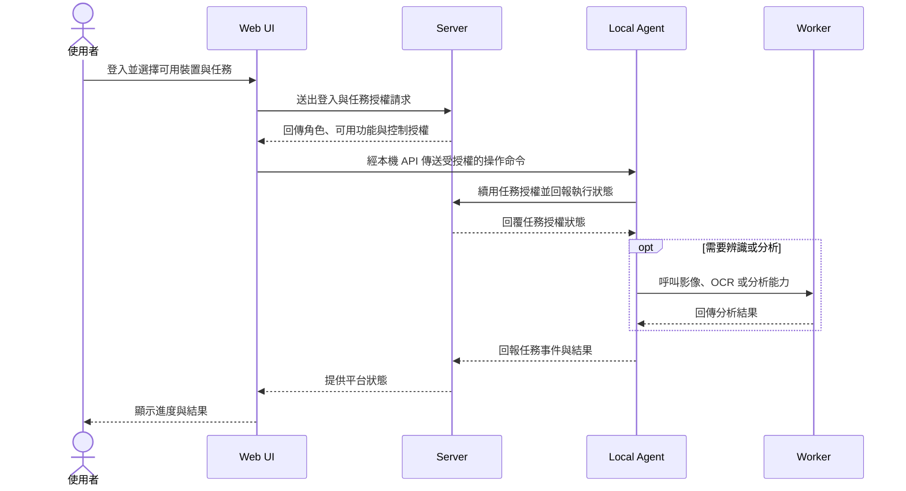

# 多使用者遊戲操作平台

針對多人從 Web 控制台管理遊戲、裝置與任務，但操作必須在各自 Windows 電腦執行的情境，將平台授權交由 Java Server 管理、本機操作交由 Windows Agent 執行，Python Worker 則按需提供辨識與分析能力。

## 使用與執行流程

使用者在瀏覽器操作；Agent 安裝並執行於使用者要控制的 Windows 電腦。Worker 不提供另一個使用者入口，由 Agent 按任務需要呼叫。UI 與 Agent 的本機控制使用短效授權；任務能否繼續由 Server 持有的授權狀態決定。

## 元件職責

- **使用者端：**使用者在瀏覽器登入、選擇自己可用的裝置與任務，並查看執行狀態。
- **Web UI｜Vue 3：**唯一產品操作入口，提供登入、裝置／任務操作、狀態呈現與管理介面；不保存敏感規則，也不裁決最終授權。
- **Java Server｜Spring Boot：**管理帳號角色、裝置歸屬、功能資格、任務授權與平台狀態；後台管理 API 受管理員角色保護。
- **Windows Agent｜Java：**在使用者電腦檢查本機環境、執行桌面操作，並管理本機任務生命週期與資源清理；不自行決定帳號資格或平台政策。
- **Python Worker：**按需提供 OCR、影像處理與分析工具；由 Agent 呼叫，不管理使用者、平台授權或整體任務生命週期。

### 多使用者與權限

帳號角色分為一般使用者與管理員。Server 依使用者身份管理裝置歸屬與可用功能；一般操作限於該使用者可用的裝置，使用者管理等後台功能由管理員權限保護。控制租約與任務租約分別限制「誰能控制本機 Agent」及「任務是否仍可執行」。

## 後端架構

Server 以 Java 21、Spring Boot 3.3.1 建置，按帳號、裝置、授權、遊戲等領域模組組織。Web UI 管理使用者操作與呈現，Agent 擁有本機執行生命週期，Worker 封裝可替換的分析工具。三者分工避免把平台授權、桌面操作和影像分析塞在同一個元件。

- **Web 控制台：**Vue 3、Element Plus、Vite。
- **平台 Server：**Java 21、Spring Boot、PostgreSQL、JWT。
- **本機 Agent：**Java，負責 Windows 桌面與裝置執行管理。
- **分析 Worker：**Python、FastAPI、OpenCV、OCR。

## 設計考量

- **平台授權與本機執行分開：**Server 掌握身份、裝置與任務授權；Agent 只執行獲得授權的本機操作。
- **生命週期由單一元件負責：**Agent 管理本機任務啟停、長時間執行與清理；Worker 回傳分析能力，不跨任務接管控制。
- **分析工具可替換：**將 OCR／影像分析留在 Worker，讓桌面操作流程不依賴單一分析實作。
