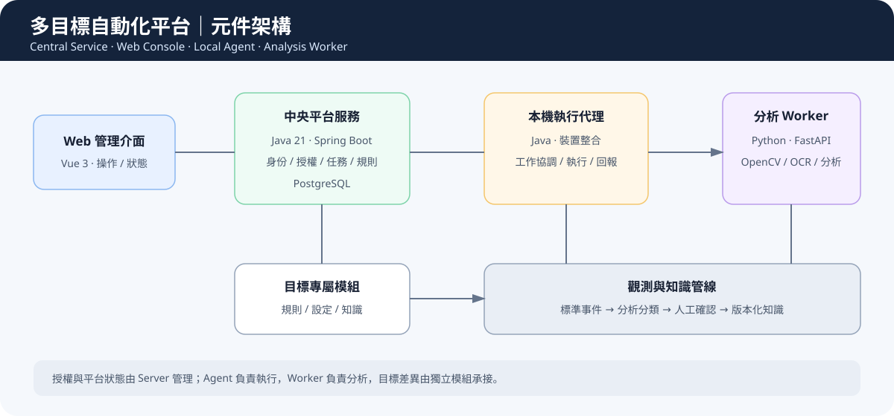
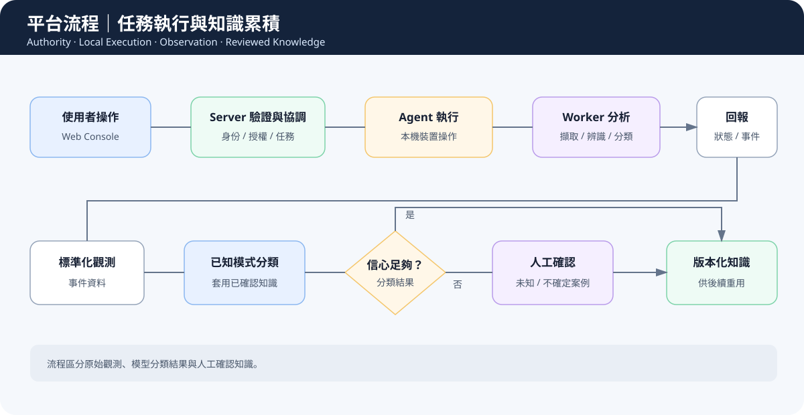

# 自動化與訊號分析平台

**技術：** Java 21、Spring Boot 3.3.1、PostgreSQL、Vue 3、Python 3.11+、FastAPI、OpenCV、OCR。

## 專案目的

中央服務協調身份、授權與任務；本機 Agent 執行工作，分析 Worker 處理觀測資料，目標專屬規則與知識由獨立模組管理。

## 架構分層

- **Server**：平台 API、身份／授權、任務狀態與規則。
- **Web UI**：操作入口與狀態呈現。
- **Local Agent**：本機裝置整合、執行協調與結果回報。
- **Analysis Worker**：擷取、辨識與分析工具。
- **Target modules**：目標專屬設定、規則與知識。

## 執行與知識流程

[架構細節](docs/architecture.md) · [流程說明](docs/workflow.md)

## 後續優化方向（設計建議）

- 為 Server、Agent 與 Worker 的版本化資料契約加入相容性檢查，並定義任務狀態轉換。
- 為任務識別碼與回報事件加入冪等處理及跨元件追蹤，支援重試與問題定位。

English: A multi-language automation and signal-analysis platform with a central server, web UI, local agent, and analysis workers.
