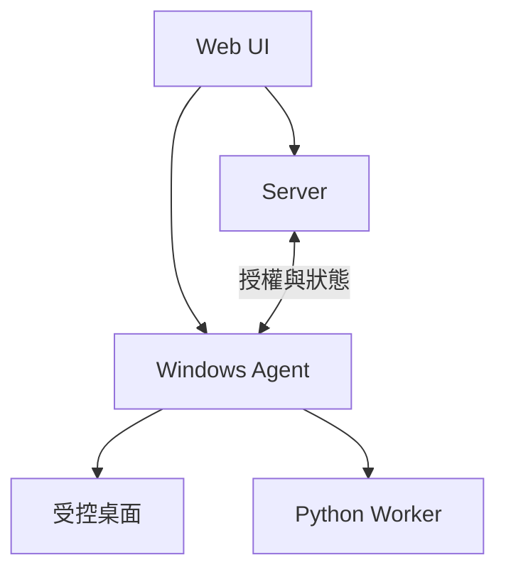

# 桌面端控制與自動化平台

平台集中管理操作授權，由安裝在受控電腦上的 Agent 執行桌面操作；影像與 OCR 工作交由 Worker 處理。

## 系統架構

- **Web UI｜Vue 3** — 操作入口，呈現裝置與任務狀態。
- **Server｜Java 21、Spring Boot 3.3.1、PostgreSQL** — 管理身份、權限、裝置政策與任務狀態。
- **Windows Agent｜Java** — 在受控電腦執行桌面操作，管理任務生命週期與資源清理。
- **Python Worker｜Python、FastAPI、OpenCV、OCR** — 提供 Agent 按需呼叫的影像擷取與分析工具。

## 任務流程

1. 使用者選擇裝置與任務。
2. Server 檢查身份、裝置權限與任務政策。
3. Agent 確認授權後，在本機檢查環境並執行桌面操作。
4. 有分析需求時，Agent 呼叫 Worker，取得影像或文字分析結果。
5. Agent 回報狀態與結果；Server 更新平台狀態供 Web UI 呈現。

## 架構邊界

Server 是平台授權與狀態的依據；Agent 負責本機執行、工作階段與清理；Worker 只提供分析工具，不負責整體任務控制。
