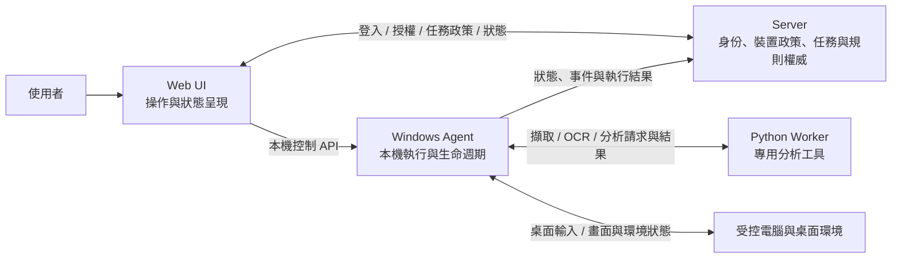
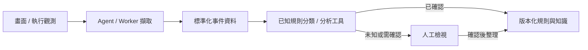

# 桌面端控制與自動化平台

透過 Web UI 操作桌面控制任務；Server 負責帳號、授權與任務政策，Windows Agent 在本機執行並管理桌面操作，Python Worker 提供 OCR、影像及分析工具。

## 技術組成

| 元件 | 技術 | 用途 |
|---|---|---|
| Web UI | Vue 3、Element Plus、Vue Router、Pinia、Vite | 操作控制台、裝置／任務狀態呈現 |
| Server | Java 21、Spring Boot 3.3.1、PostgreSQL | 身份、授權、裝置政策、任務協調與規則版本 |
| Windows Agent | Java | 本機環境整合、桌面操作、任務生命週期、呼叫 Worker、狀態回報 |
| Python Worker | Python、FastAPI、OpenCV、OCR | 被 Agent 呼叫的擷取、影像辨識與分析工具 |

## 元件各司其職

- **Web UI：操作入口。** 使用者透過它登入、選擇裝置與操作任務、查看狀態；不負責授權裁決或本機桌面 I/O。
- **Server：平台權限與狀態的權威來源。** 管理帳號、裝置政策、授權、任務狀態與規則版本；決定任務能否開始或繼續。
- **Windows Agent：本機執行與生命週期管理者。** 負責環境檢查、桌面／裝置控制、任務啟停、Worker 呼叫、資源清理與結果回報。
- **Python Worker：專用工具層。** 執行 OCR、影像處理與分析等 Python 工具；回傳結果給 Agent，不擁有平台授權或跨任務生命週期。

## 系統架構

## 觀測資料流程

## 後續優化方向（設計建議）

- 為 Web UI、Server、Agent、Worker 的資料契約加上相容性檢查與版本升級規則。
- 為任務狀態與執行回報建立端到端追蹤及冪等識別，方便處理重試與異常復原。

English: A desktop-control system where the Web UI operates, the Server authorizes, the local Agent executes, and the Worker analyzes.
