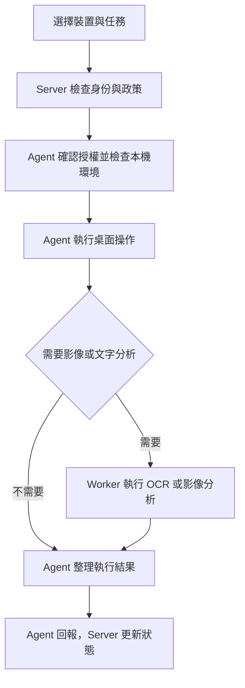
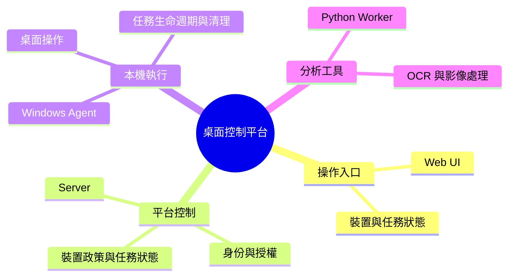

# 桌面端控制與自動化平台

將平台授權與本機桌面執行分開：Server 管理身份與任務政策，Windows Agent 在受控電腦執行操作，Worker 提供專用分析工具。

## 任務流程

## 架構心智圖

## 元件技術

- **Web UI：** Vue 3
- **Server：** Java 21、Spring Boot 3.3.1、PostgreSQL
- **Windows Agent：** Java
- **Python Worker：** Python、FastAPI、OpenCV、OCR

## 設計考量

- **授權與執行分離：** Server 維持平台政策與狀態，Agent 僅在本機執行已授權任務。
- **分析與控制分離：** Worker 回傳影像或文字分析結果，Agent 保有任務啟停、生命週期與資源清理責任。
- **適用情境：** 需要平台統一控管，又必須在使用者電腦執行桌面操作的工作。
