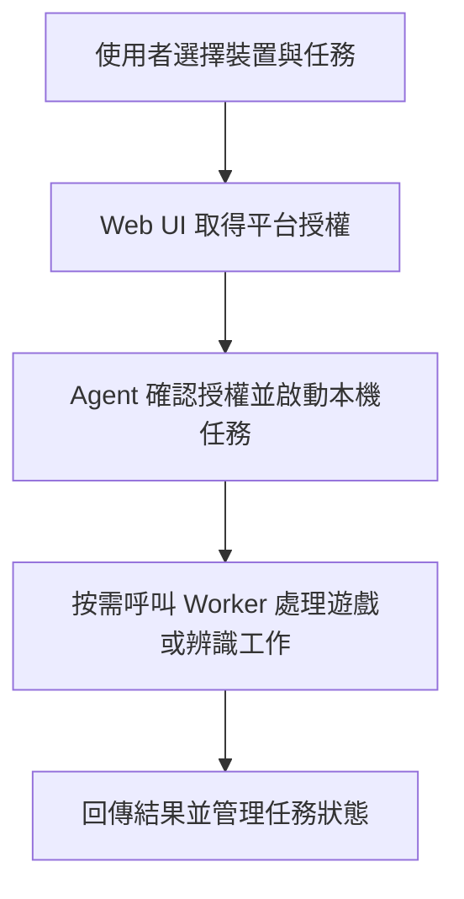

# 遊戲操作平台｜元件與程式分層

使用者透過 Web UI 操作，由 Server 管理授權，Agent 在本機執行任務，Worker 按需提供遊戲與辨識能力。

## 任務協作

實際操作依遊戲及任務類型使用不同路徑；Worker 依需要呼叫。

## 元件與分層

### Web UI · Vue

**職責**｜提供登入、裝置與任務操作，呈現狀態。

**程式分工**｜畫面與元件呈現介面；stores／composables 整理狀態及共用操作；API 模組分別連接 Server 與本機 Agent。

### Server · Java

**職責**｜管理帳號、裝置與使用資格，作為平台授權的依據。

**程式分工**｜依領域拆分模組。以裝置為例，Controller 接收請求，應用服務處理註冊及查詢，資料存取程式管理裝置資料。

### Windows Agent · Java

**職責**｜在使用者電腦執行任務，管理本機 session 的啟停與資源清理。

**程式分工**｜本機 API 接收操作；應用服務管理 session；領域與基礎設施程式處理授權查詢及執行環境。任務啟動前會再次向 Server 確認授權。

### Worker · Python

**職責**｜提供遊戲相關處理、影像與 OCR 等能力。

**程式分工**｜FastAPI 路由接收請求，再由應用服務及遊戲模組處理；Agent 負責整體本機 session 的生命週期。

## 設計考量

- **授權與執行分開：**Server 管理資格，Agent 在本機執行前再次確認。
- **任務與工具分開：**Agent 管理任務與資源；Worker 提供按需呼叫的處理能力。
- **遊戲能力獨立：**平台共用功能與遊戲相關處理分屬不同元件，方便各自維護。
