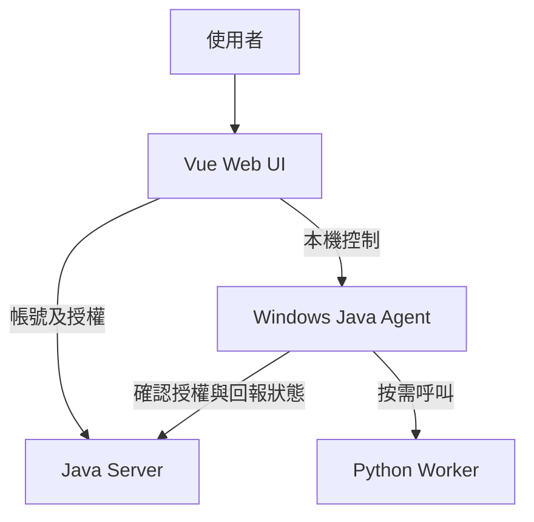

# 遊戲操作平台｜元件與分層範例

依現有程式目錄及元件職責整理，範例名稱與資料均經簡化，用於展示設計邊界。

## 元件關係



- **Vue Web UI：**畫面、狀態與操作入口；將平台請求和本機操作分別交給對應 API。
- **Java Server：**帳號、裝置、權限及授權狀態；管理平台資料與政策。
- **Windows Agent：**使用者電腦上的本機 API、任務生命週期、資源協調與清理。
- **Python Worker：**遊戲相關處理、影像與 OCR 等能力；由 Agent 按需呼叫，不負責平台授權或整體任務生命週期。

## 元件內部怎麼分層

```text
Web UI        views / components → stores / composables → api
Java Server   API → 應用服務 → 領域與資料存取（依領域模組組織）
Windows Agent runtime/api → application → domain / infrastructure
Python Worker api → application → domain / infrastructure / games
```

目錄依目前專案結構歸納，並非所有用例都經過完全相同的路徑。`games` 承載遊戲相關能力；Agent 管理本機 session 與清理，Worker 提供被呼叫的能力。

## 簡化呼叫示意

```javascript
// Vue：透過 API 層送出使用者操作
async function startTask(task) {
  return agentApi.startTask(task)
}
```

```java
// Agent：協調任務生命週期與 Worker 呼叫
void startTask(Task task) {
    authorize(task);
    session.start(task);
    worker.analyze(task);
}
```

```python
# Worker：提供單一分析能力
def analyze(image):
    return recognize(preprocess(image))
```

以上是說明責任分工的概念片段，並非原始程式碼或可執行範例；實際授權與執行流程依任務路徑而異。
