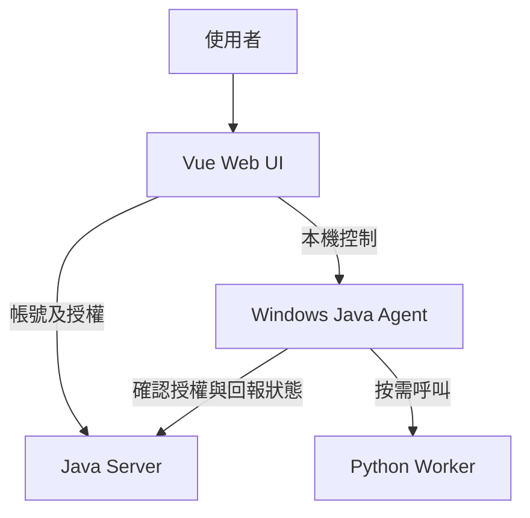

# 遊戲操作平台｜元件與程式分層

以平台授權、本機執行與遊戲能力的分工組織程式。

## 元件關係



- **Vue Web UI：**畫面、狀態與操作入口；將平台請求和本機操作分別交給對應 API。
- **Java Server：**帳號、裝置、權限及授權狀態；管理平台資料與政策。
- **Windows Agent：**使用者電腦上的本機 API、任務生命週期、資源協調與清理。
- **Python Worker：**遊戲相關處理、影像與 OCR 等能力；由 Agent 按需呼叫，不負責平台授權或整體任務生命週期。

## 元件內部分層

```text
Web UI        views / components → stores / composables → api
Java Server   API → 應用服務 → 領域與資料存取（依領域模組組織）
Windows Agent runtime/api → application → domain / infrastructure
Python Worker api → application → domain / infrastructure / games
```

目錄依目前專案結構歸納，並非所有用例都經過完全相同的路徑。`games` 承載遊戲相關能力；Agent 管理本機 session 與清理，Worker 提供被呼叫的能力。

## 程式結構對照

- Web UI 的 `src/api` 包含平台 API 與本機 Agent API，畫面及狀態相關程式分布於 `views`、`components`、`stores` 等目錄。
- Server 的裝置模組包含 API 與 application 目錄，可看到 Controller 與應用服務分開。
- Agent 的 runtime 包含 `api`、`application`、`domain`、`infrastructure`；應用層包含任務 session 與 Worker 更新相關服務。
- Worker 以 FastAPI 提供路由，並有 `application`、`domain`、`infrastructure` 與 `games` 等目錄；不同遊戲與執行路徑的成熟度不同。
