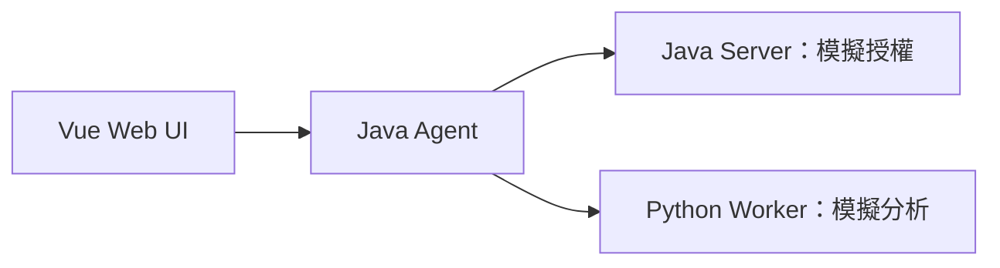

# 多元件協作 demo

以虛構帳號與裝置展示 Web UI、Java Server、Windows Agent 與 Python Worker 的責任分工。



此 demo 的授權規則與分析結果均為示範，沒有真實登入、租約、桌面操作、遊戲邏輯或 OCR；本機 Agent 啟動任務時向 Server 再次確認，成功後呼叫 Worker。這些簡化不代表原系統的完整安全機制。

## 啟動

需要 JDK 21、Maven、Python 3.10 以上及 Node.js 20 以上；以下在四個終端分別執行：

```bash
cd server
mvn spring-boot:run
```

```bash
cd worker
python -m pip install -r requirements.txt
python -m uvicorn app:app --host 127.0.0.1 --port 18083
```

```bash
cd agent
java --add-modules jdk.httpserver Agent.java
```

```bash
cd web
npm install
npm run dev
```

開啟 Vite 顯示的本機網址，點擊「執行示範任務」。Server 的授權測試可在 `server` 目錄執行 `mvn test`。

僅限本機展示；全部使用虛構資料，請勿用於真實授權或正式環境。
