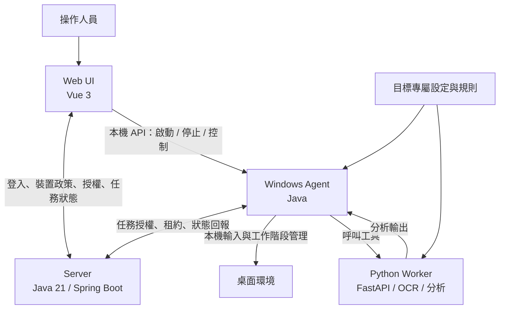

# 桌面端控制平台架構

## 分層與責任

| 元件 | 責任邊界 | 不承擔的責任 |
|---|---|---|
| Web UI（Vue 3） | 使用者操作入口、狀態／報表顯示、裝置與任務控制 | 不持有最終授權、平台規則真相或桌面控制能力 |
| Server（Java 21 / Spring Boot） | 帳號、授權、裝置政策、任務協調、狀態與規則版本 | 不直接執行本機桌面輸入 |
| Windows Agent（Java） | 本機環境與桌面整合、任務生命週期、呼叫 Worker、資源清理、狀態回報 | 不取代 Server 做最終授權裁決 |
| Python Worker（FastAPI） | OCR、影像處理、擷取與分析工具 | 不擁有全域任務生命週期、平台授權或跨任務清理 |
| 目標模組 | 承載特定控制目標的設定、規則與知識 | 不複製平台共用控制骨架 |

## 元件互動

## 為什麼拆成這些元件

- **控制入口與執行環境不同。** Web UI 適合承載操作流程；桌面控制需要本機環境與權限，因此由 Agent 執行。
- **授權裁決與本機執行分開。** Server 維持平台狀態與政策；Agent 執行已授權工作並回報狀態。
- **分析工具獨立。** OCR 與影像分析使用 Python 工具，由 Agent 按需呼叫；Worker 不負責整個任務的啟停與善後。
- **目標差異留在模組邊界。** 共用控制生命週期留在平台元件，目標設定、規則和知識由模組提供。

## 跨元件契約

Server、Agent、Worker 依明確 DTO／事件契約與版本協作。授權、任務狀態與規則版本以 Server 為準；本機觀測和分析結果沿執行鏈回報。
