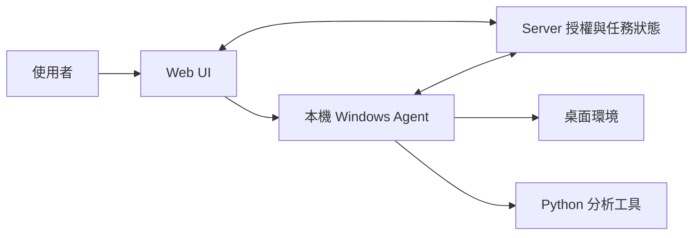

# 桌面端控制平台架構

| 元件 | 技術 | 職責 |
|---|---|---|
| Web UI | Vue 3 | 操作入口與狀態呈現 |
| Server | Java 21、Spring Boot 3.3.1、PostgreSQL | 身份、權限、裝置政策與任務狀態 |
| Windows Agent | Java | 本機桌面操作、任務生命週期與資源清理 |
| Python Worker | Python、FastAPI、OpenCV、OCR | 按需執行擷取與分析工具 |

Server 管理平台授權；Agent 執行本機操作並管理任務；Worker 只提供 Agent 呼叫的分析工具。
