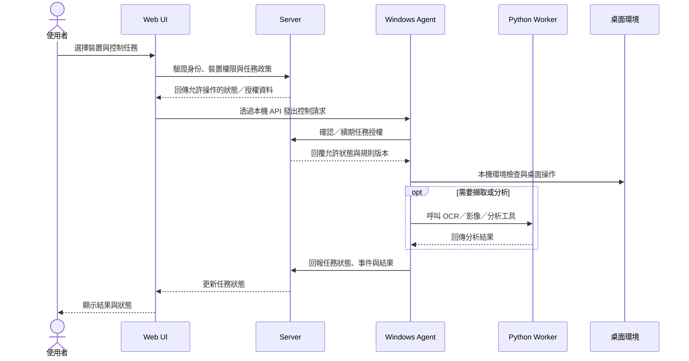

# 桌面控制任務流程

## 執行責任

1. Web UI 負責人機操作與狀態呈現。
2. Server 檢查帳號、裝置和任務政策，並維護授權與規則狀態。
3. Agent 在受控電腦執行操作，管理工作階段並負責啟停與資源清理。
4. Worker 只在 Agent 呼叫時提供分析工具，回傳結果後由 Agent 繼續控制任務。
5. 執行觀測轉成標準事件；需判讀的未知結果進入確認流程，確認後再整理為版本化知識。

English: The Web UI requests a task, the Server authorizes it, the local Agent operates the desktop, and the Worker returns analysis results.
